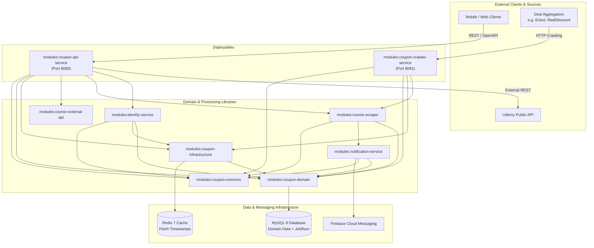
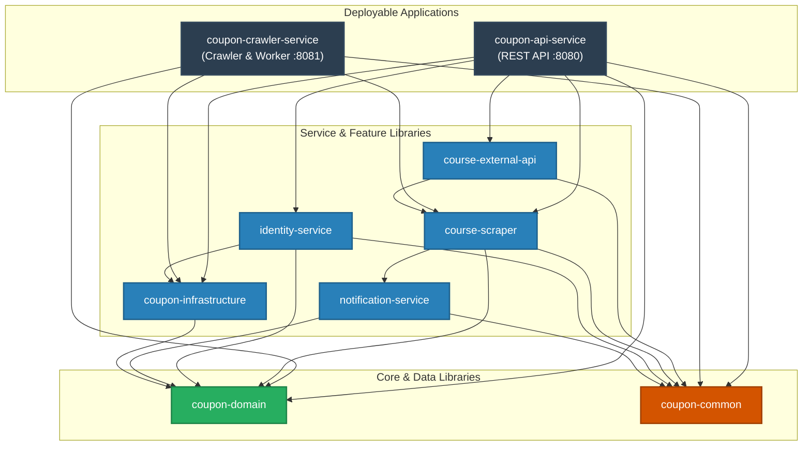
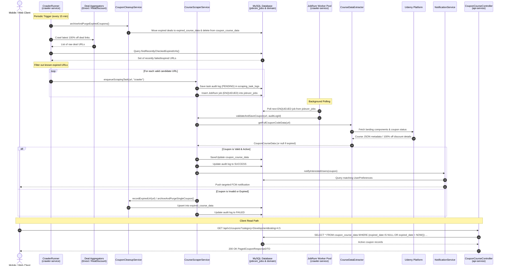

# Architecture Overview — Course Deal Backend

This document details the system design, modular breakdown, and end-to-end data flows for the Course Deal Server. For domain rules and crawling heuristics, see [docs/business-logic.md](business-logic.md). For architectural decisions, see [docs/adr/](adr/).

---

## 1. High-Level Architecture & Topology

The backend is built as a Kotlin/Spring Boot multi-module system (`settings.gradle.kts`) divided into 9 modules. These modules separate core data, cross-cutting infrastructure, and background processing from deployable artifacts.



### Why Two Deployables?

1. **Separation of Discovery from Serving:**
   - `coupon-api-service` serves user-facing REST traffic (`/api/v1/coupons`, authentication, user preferences). It must remain low-latency, responsive, and horizontally scalable.
   - `coupon-crawler-service` runs long-lived background coroutines (`CrawlerRunner`) that pull deals from third-party websites on a 15-minute schedule, and hosts the JobRunr worker server (`BackgroundJobServer`).
2. **Resource Isolation:**
   - Crawling and Jsoup-based HTML parsing are CPU- and outbound-network-intensive. Running them in a dedicated deployable ensures background scraping spikes never starve or degrade user-facing REST endpoints.
3. **Decoupled Deployment Lifecycle:**
   - Scraper heuristics and aggregator parsers change frequently due to third-party website layout updates. Deploying the crawler independently allows updating scraping logic without interrupting active user sessions or API consumers.

---

## 2. Module Breakdown (9 Modules)

The project adheres to strict dependency layering. Domain and common modules do not import deployables, and deployables only depend on the libraries they actually require.

### Inter-Module Gradle Dependency Graph

The diagram below reflects the exact `project(":modules:...")` dependencies declared across each module's `build.gradle.kts`:



```
modules/
├── coupon-common             # Leaf utility library (logging, shared exceptions)
├── coupon-domain             # Entities, repositories, DTOs, Flyway migrations
├── coupon-infrastructure     # Redis configuration and caching
├── notification-service      # Firebase Admin SDK & FCM push notifications
├── course-scraper            # JobRunr validation pipeline & Jsoup extractor
├── course-external-api       # Udemy public REST client
├── identity-service          # Auth (OAuth2, Passkeys/WebAuthn, JWT) & preferences
├── coupon-api-service        # Deployable Spring Boot REST API (port 8080)
└── coupon-crawler-service    # Deployable background discovery & worker (port 8081)
```

### 2.1 `modules:coupon-common`
- **Responsibility:** Cross-cutting utilities with zero project dependencies.
- **Key Components:**
  - `com.thanh0x.coursedeal.config.Logging`: Global inline `logger()` helper using SLF4J.
  - `com.thanh0x.coursedeal.exception.*`: Standard domain exceptions (`BadRequestException`, `ResourceNotFoundException`, `UnauthorizedException`, `InternalServerException`).
- **Dependencies:** Standard Java/Kotlin runtime, SLF4J.

### 2.2 `modules:coupon-domain`
- **Responsibility:** Pure data layer. Defines schema models, Spring Data JPA repositories, DTOs, and schema migrations. Contains no service business logic.
- **Key Components:**
  - **Entities:** `CouponCourseData` (active deals), `ExpiredCourseData` (archived deals), `User`, `Role`, `UserPreference`, `ScrapedUrlMapping`, `SocialAccount`, `PasskeyCredential`, `ScrapingTaskLog`.
  - **Repositories:** `CouponCourseRepository`, `ExpiredCouponRepository`, `UserRepository`, `RoleRepository`, `UserPreferenceRepository`, `PasskeyCredentialRepository`, `SocialAccountRepository`, `ScrapedUrlMappingRepository`, `ScrapingTaskLogRepository`.
  - **DTOs:** `CouponSummaryDTO`, `CouponDetailDTO`, `CouponQueryDTO`, `PagedCouponResponseDTO`, `AuthDTO`, etc.
  - **Migrations:** Flyway SQL scripts located in `src/main/resources/db/migration/` (`V1` to `V8`).
- **Dependencies:** Spring Data JPA, Hibernate, Flyway, MySQL Connector, Jakarta Validation.

### 2.3 `modules:coupon-infrastructure`
- **Responsibility:** Redis caching setup and timestamp state management.
- **Key Components:**
  - `com.thanh0x.coursedeal.config.RedisConfig`: Lettuce connection factory and `StringRedisTemplate` bean.
  - `com.thanh0x.coursedeal.service.RedisService`: Wrapper singleton for low-level key-value Redis operations.
  - `com.thanh0x.coursedeal.utils.LastFetchTimeManager`: Manages the `last_fetch_time` Redis key used to track the latest crawler execution across restarts.
- **Dependencies:** `coupon-domain`, Spring Data Redis, Lettuce.

### 2.4 `modules:notification-service`
- **Responsibility:** Push notification delivery via Firebase Admin SDK.
- **Key Components:**
  - `com.thanh0x.coursedeal.config.FirebaseConfig`: Initializes `FirebaseApp` using Google service account credentials. Gracefully disables FCM if credentials are not configured.
  - `com.thanh0x.coursedeal.service.NotificationService`: Queries user preferences (`UserPreferenceRepository`) for category and keyword matches against newly scraped coupons, and sends targeted multicast notifications (`sendMulticastNotification`).
- **Dependencies:** `coupon-domain`, `coupon-common`, Google Firebase Admin SDK (`firebase-admin`).

### 2.5 `modules:course-scraper`
- **Responsibility:** Background coupon validation, web extraction, and expired coupon cleanup.
- **Key Components:**
  - `com.thanh0x.coursedeal.service.CourseScraperService`: JobRunr job coordinator. Enqueues background scraping jobs (`enqueueScrapingTask`) and executes `validateAndSaveCoupon` inside background workers.
  - `com.thanh0x.coursedeal.service.CouponCleanupService`: Identifies expired coupons (`expiredDate <= now`), archives their metadata into `expired_course_data`, and purges them from `coupon_course_data`.
  - `com.thanh0x.coursedeal.crawlerrunner.CourseDataExtractor`: Fetches Udemy course landing page components using Jsoup and raw HTTP client to extract coupon codes, pricing, and expiration dates.
  - `com.thanh0x.coursedeal.crawlerrunner.fetcher.WebContentFetcher`: Safe HTTP fetcher that extracts redirected final URLs and parses JSON responses.
- **Dependencies:** `coupon-domain`, `notification-service`, `coupon-common`, JobRunr Spring Boot starter, Jsoup.

### 2.6 `modules:course-external-api`
- **Responsibility:** Direct integration client for official Udemy REST API endpoints.
- **Key Components:**
  - `com.thanh0x.coursedeal.externalapi.ExternalCourseApiClient`: Client calling Udemy API v2.0 using HTTP Basic Authentication (`client_id` / `client_secret`).
  - `com.thanh0x.coursedeal.config.ExternalApiProperties`: Configuration holding Udemy API credentials and base URL.
- **Dependencies:** `course-scraper`, `coupon-common`, Spring Web (`RestTemplate`).

### 2.7 `modules:identity-service`
- **Responsibility:** Identity & Access Management (IAM), biometric passkeys, social auth, and user preferences.
- **Key Components:**
  - `com.thanh0x.coursedeal.service.SocialAuthService`: Validates Google and Apple ID tokens, resolves existing users or provisions new accounts, and issues JWT tokens.
  - `com.thanh0x.coursedeal.service.PasskeyService`: Implements FIDO2 WebAuthn ceremony (registration options, credential verification, assertion options, assertion verification) using `webauthn-server-core`.
  - `com.thanh0x.coursedeal.service.UserPreferenceService`: Manages user keyword subscriptions and notification settings.
  - `com.thanh0x.coursedeal.security.JwtProvider` & `TokenAuthenticationFilter`: JWT creation, parsing, validation, and Spring Security context population.
- **Dependencies:** `coupon-domain`, `coupon-common`, `coupon-infrastructure`, Spring Security, JJWT, Yubico `webauthn-server-core`.

### 2.8 `modules:coupon-api-service` (Deployable)
- **Responsibility:** Public-facing REST API server on port 8080.
- **Key Components:**
  - `com.thanh0x.coursedeal.controller.CouponCourseController`: Endpoints for coupon listing (`GET /api/v1/coupons`), detail retrieval (`GET /api/v1/coupons/{courseId}`), and manual coupon submission (`POST /api/v1/coupons`).
  - `com.thanh0x.coursedeal.controller.AuthController` & `PasskeyAuthController`: REST endpoints for Google/Apple OAuth2 and Passkey handshakes.
  - `com.thanh0x.coursedeal.controller.UserPreferenceController`: Endpoints for managing user notification criteria.
  - `com.thanh0x.coursedeal.service.CourseResponseService`: Query service applying active filtering (`expiredDate IS NULL OR expiredDate > now`) and local sorting metadata.
  - `com.thanh0x.coursedeal.config.OpenApiConfig`: SpringDoc OpenAPI 3.0 / Swagger UI setup (`/swagger-ui.html`).
  - `com.thanh0x.coursedeal.exception.GlobalExceptionHandler`: `@RestControllerAdvice` mapping domain exceptions to standard HTTP error responses.
- **Dependencies:** Composes `coupon-domain`, `coupon-common`, `coupon-infrastructure`, `course-scraper`, `course-external-api`, `identity-service`, Spring Boot Web, SpringDoc OpenAPI.

### 2.9 `modules:coupon-crawler-service` (Deployable)
- **Responsibility:** Automated coupon discovery daemon and background JobRunr worker on port 8081.
- **Key Components:**
  - `com.thanh0x.coursedeal.crawlerrunner.CrawlerRunner`: Coroutine-based scheduler that triggers crawler runs on a configurable interval (default: 15 minutes / 900,000 ms). Starts by purging expired coupons, collecting URLs from aggregators, filtering known expired URLs, and enqueuing tasks.
  - `com.thanh0x.coursedeal.crawlerrunner.crawler.EnextCrawler`: Scrapes free coupon links from E-Next.
  - `com.thanh0x.coursedeal.crawlerrunner.crawler.RealDiscountCrawler`: Scrapes free coupon links from Real.Discount.
  - `com.thanh0x.coursedeal.config.CrawlerProperties`: Configuration properties (`intervalTime`, `numberOfRequestThread`, `skipRecentlyCheckedExpiredHours`, etc.).
  - **JobRunr Worker Server:** Runs JobRunr's `BackgroundJobServer` to execute coupon validation jobs in a managed background worker pool.
- **Dependencies:** Composes `coupon-domain`, `coupon-common`, `coupon-infrastructure`, `course-scraper`, JobRunr Spring Boot starter.

---

## 3. End-to-End Data Flow: Coupon Discovery & Processing

The following sequence diagram traces the complete lifecycle of a coupon: discovery by periodic crawlers, asynchronous background validation via JobRunr, database persistence, push notification fan-out, and eventual API retrieval.



---

## 4. Key Architectural Patterns & Decisions

### 4.1 JobRunr Storage on MySQL (ADR 0001)
Although Redis is present in the stack, JobRunr is configured to use MySQL's Spring-managed `DataSource` directly:
- **Decision:** As documented in [docs/adr/0001-jobrunr-sql-storage-over-redis.md](adr/0001-jobrunr-sql-storage-over-redis.md), JobRunr persists background jobs (`jobrunr_jobs`), recurring schedules, and server heartbeats (`jobrunr_backgroundjobservers`) in MySQL tables created via Flyway migrations.
- **Why Not Redis:** `jobrunr-spring-boot-3-starter` natively leverages the SQL `DataSource`. Using Redis would introduce an unexercised NoSQL storage dependency with no measurable performance benefit at current job throughput. Redis is strictly reserved for application caching and timestamp metadata (`LastFetchTimeManager`).

### 4.2 Active Time Filtering vs. Background Cleanup
- **Defense in Depth:** The platform does not rely solely on the background purge to hide expired deals from users.
- **Query Level:** `CouponCourseRepository` (`findAllActive`, `findByQueryAndActive`, `findWithStructuredFilters`) strictly filters out coupons where `expiredDate <= Instant.now()`.
- **Storage Level:** `CouponCleanupService` archives expired items into `expired_course_data` (updating `updated_at` timestamps for deduplication) and purges them from `coupon_course_data`.

### 4.3 Database Migrations via Flyway
- Schema changes are strictly managed via timestamped Flyway scripts under `modules/coupon-domain/src/main/resources/db/migration/` (`V<timestamp>__<description>.sql`). JPA entity definitions must never diverge from Flyway schema scripts.

---

## 5. Divergences & Known Technical Debt

The current architecture is production-ready for its current scale, but specific areas are tracked for further improvement:

| Topic | Tracking Issue | Description |
|---|---|---|
| **Rate Limiting** | [#4](https://github.com/Huythanh0x/course_deals_backend/issues/4) | The public REST API currently lacks IP- or token-based rate limiting on submission and query endpoints. |
| **Container & CI/CD Deployment** | [#5](https://github.com/Huythanh0x/course_deals_backend/issues/5) | Production docker-compose orchestration and cloud deployment pipelines are being refined. |
| **Logging & Monitoring** | [#10](https://github.com/Huythanh0x/course_deals_backend/issues/10) | Centralized structured log forwarding (e.g. Loki/Promtail or OpenTelemetry) and Prometheus metrics are not yet integrated. |
| **JobRunr Configuration** | [#13](https://github.com/Huythanh0x/course_deals_backend/issues/13) & [ADR 0001](adr/0001-jobrunr-sql-storage-over-redis.md) | Resolved: Spring Boot 3 property prefix for JobRunr was corrected from `org.jobrunr` to `jobrunr`, fixing `BackgroundJobServer` initialization. |
| **Superseded Docs** | [#8](https://github.com/Huythanh0x/course_deals_backend/issues/8) | Closed: superseded by this unified architecture document and issue #15. |
