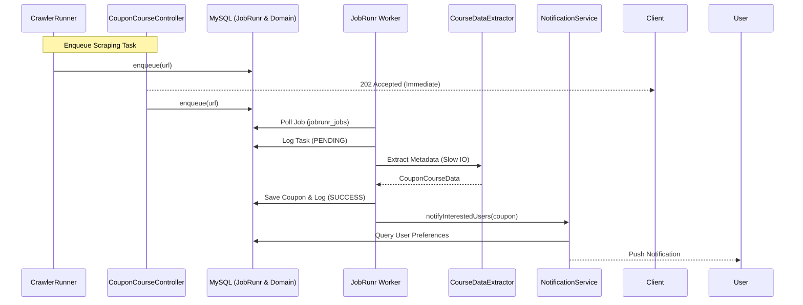

# Business Logic & Flow - Course Deal Server

## Module Map
- **`coupon-common`**: Cross-cutting utilities (logging helper, shared exceptions) used by nearly every other module. No framework-specific infra deps of its own beyond what those utilities need.
- **`coupon-domain`**: Pure data layer. Contains DTOs, JPA entities, repositories, and Flyway migrations. No infrastructure or logic dependencies.
- **`coupon-infrastructure`**: Redis caching/config only (`RedisConfig`, `RedisService`, `LastFetchTimeManager`).
- **`notification-service`**: Firebase Admin SDK (FCM) push notifications (`FirebaseConfig`, `NotificationService`).
- **`course-scraper`**: Specialized domain-specific I/O shared by both deployables. Contains the `CourseScraperService` (JobRunr-backed validation pipeline) and `CourseDataExtractor`.
- **`course-external-api`**: Client for Udemy's public course API (`ExternalCourseApiClient`), used only by `coupon-api-service`.
- **`identity-service`**: Dedicated module for Identity and Access Management (IAM). Handles Social Auth, Passkey handshakes, and User Preferences.
- **`coupon-api-service`**: Business REST stack. Focused purely on course searching, filtering, and detail retrieval.
- **`coupon-crawler-service`**: Background discovery workers that periodically find new course deals and hand them off to `course-scraper` via JobRunr.

## High-Level Architecture
- **Discovery Layer** (`coupon-crawler-service`): Periodically pulls URLs from multiple sources. It does not validate URLs itself; it enqueues them into **JobRunr**.
- **Background Processing** (`CourseScraperService`): A persistent background pipeline powered by **JobRunr** that validates coupons. It handles Udemy API interaction and persists results with full audit logging and automatic retries.
- **Modern Auth** (`SocialAuthController`, `PasskeyAuthController`): Secure, password-less authentication supporting Google, Apple, and Biometric Passkeys.
- **Personalized Notifications** (`NotificationService`): Matches newly discovered coupons against user-defined keywords/categories and sends targeted FCM push notifications.

## Coupon Discovery, Validation & Smart Refresh Pipeline
1. **Discovery:** `CrawlerRunner` fires every 15 minutes (`EnextCrawler` and `RealDiscountCrawler` collect raw URLs).
2. **Smart Active-Coupon Re-Validation:** `CrawlerRunner` also periodically re-validates existing active coupons in the database (`revalidateActiveCoupons`) and automatically purges/marks expired deals so stale deals don't linger in client feeds.
3. **Queue Handoff:** Discovered URLs are passed to `CourseScraperService.enqueueScrapingTask()`.
4. **Validation (Background Worker):**
   - JobRunr picks up the task from SQL storage (`jobrunr_jobs` in MySQL — see [ADR 0001](adr/0001-jobrunr-sql-storage-over-redis.md)).
   - `CourseDataExtractor` uses Jsoup to pull course metadata.
   - The result is audited in the `scraping_task_logs` table, and unexpected scraping errors are reported to Sentry via `ErrorTrackingReporter`.
   - If a provider is down, JobRunr automatically retries with exponential backoff.
5. **Persistence & Alerts:**
   - Valid coupons are saved to `CouponCourseRepository`.
   - `NotificationService` checks user preferences and sends targeted FCM pushes.

## Coupon & App Config API Behavior
- **`GET /api/v1/coupons`**: Returns a paged list of coupons. Supports remote filtering by category, rating, language, search query, and sorting.
- **`GET /api/v1/coupons/hot-deals`**: Returns top trending/expiring coupons tailored to the user's favorite categories/keywords (with automatic fallback to global top deals by student enrollment count), powering mobile and Apple Watch companion widgets/views.
- **`GET /api/v1/app/config`**: Public endpoint returning `minSupportedVersionCode`, `latestVersionCode`, `forceUpdateUrl`, and dynamic `featureFlags` (`clientVerificationEnabled`, `communityReportsEnabled`, `preferExternalBrowserCheckout`, `enrollFlowReportThreshold`).
- **`POST /api/courses/{courseId}/reports`**: Allows users to report expired or broken coupons, triggering re-validation when the report threshold is reached.
- **Local Filtering/Sorting**: The API response (`CouponSummaryDTO`) includes rich metadata to allow clients to filter and sort: `language`, `rating`, `students`, `reviews`, `expiredTime`, `newest` (`createdAt`).

## Authentication System
- **Passwordless Email OTP & Password Auth:** `AuthController` supports `POST /api/v1/auth/send-otp`, `POST /api/v1/auth/verify-otp`, `POST /api/v1/auth/login`, `POST /api/v1/auth/register`, and `POST /api/v1/auth/refresh`.
- **Social Login:** Validates Google/Apple ID tokens (`POST /api/v1/auth/social/login`, plus `mock-login` in local/mobile-local profiles) and issues a server-side JWT.
- **Passkeys (WebAuthn):** Two-step biometric handshake (Registration & Authentication) using FIDO2 standards (`/api/v1/auth/passkey/*`).
- **Device Tokens & Terms Acceptance:** `POST /api/v1/users/device-token` registers FCM tokens & topic subscriptions; `POST /api/v1/users/me/accept-terms` records legal consent; `DELETE /api/v1/users/me` performs GDPR/Store-compliant account deletion.
- **Security:** `TokenAuthenticationFilter` verifies JWTs and checks active Redis session keys (`auth:session:<sid>`).

## Sequence Diagram (JobRunr Flow)

## Implementation Touchpoints
- `com.thanh0x.coursedeal.crawler_runner.CrawlerRunner` (in `crawler-service`) – URL discovery loop.
- `com.thanh0x.coursedeal.service.CourseScraperService` (in `course-scraper`) – Core background scraping logic.
- `com.thanh0x.coursedeal.controller.CouponCourseController` (in `api-service`) – REST API for coupons.
- `com.thanh0x.coursedeal.controller.SocialAuthController` (in `identity-service`) – OAuth2 token exchange.
- `com.thanh0x.coursedeal.controller.PasskeyAuthController` (in `identity-service`) – WebAuthn biometric flow.

Use this document to understand the decoupled nature of the "Discovery" and "Processing" layers of the platform.
