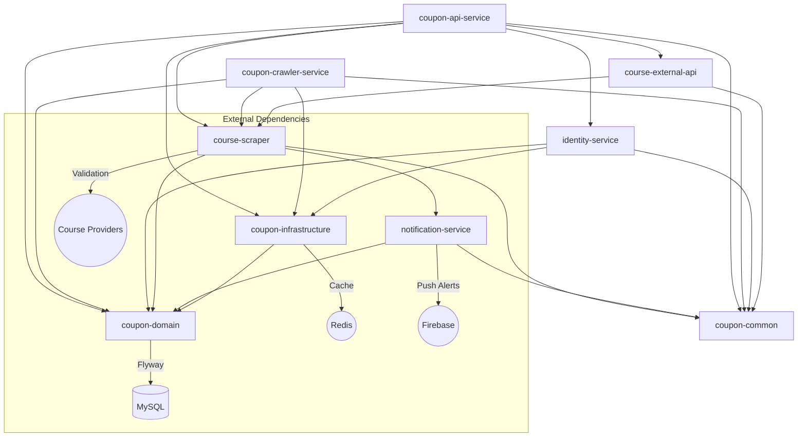

# Getting Started

## Overview
`Course Deal Server` is a modern, asynchronous multi-module backend designed for high performance and security.



### Module Breakdown:
- **`modules/coupon-common`**: Cross-cutting utilities (logging helper, shared exceptions) used by nearly every other module.
- **`modules/coupon-domain`**: Pure data layer. Entities are mapped to MySQL via JPA.
- **`modules/coupon-infrastructure`**: Redis caching/config only.
- **`modules/notification-service`**: Firebase Admin SDK (FCM) push notifications.
- **`modules/course-scraper`**: Coupon scraping/validation pipeline shared by both deployables (JobRunr-backed on MySQL).
- **`modules/course-external-api`**: Client for Udemy's public course API, used only by `coupon-api-service`.
- **`modules/identity-service`**: Standalone authentication (Social/Passkey) and user preferences.
- **`modules/coupon-api-service`**: Main REST entry point for course searching and details.
- **`modules/coupon-crawler-service`**: Periodic discovery workers and background job worker.

## Prerequisites
- Java 17 JDK in your `$PATH`.
- Docker Desktop (or compatible) for MySQL and Redis.
- Ports `3306` (MySQL), `6379` (Redis), `8080` (API), and `8081` (Crawler) should be available.

## Bootstrap the Project
```bash
git clone https://github.com/huythanh0x/course-deal-server
cd course-deal-server
```

### Option A: Production Stack via Docker
```bash
docker compose -f docker-compose.prod.yml up
```
Starts the entire backend using pre-built images. Requires a `.env` file with production secrets.

### Option B: Local Development
1. Start data containers:
```bash
docker compose -f docker-compose.local.yml up -d
```
2. Run services from source:
```bash
./gradlew :modules:coupon-api-service:bootRun --args='--spring.profiles.active=local'
# In a separate terminal
./gradlew :modules:coupon-crawler-service:bootRun --args='--spring.profiles.active=local'
```

## Database Migrations
- Schema changes and seed data are managed by [Flyway](https://flywaydb.org/).
- Migration scripts live under `modules/coupon-domain/src/main/resources/db/migration` (e.g., `V1__init_schema.sql`).
- When the Spring Boot app starts it automatically runs pending migrations; no manual SQL is required.
- For local verification you can run `./gradlew :modules:coupon-api-service:flywayMigrate` (or the crawler equivalent) once MySQL is up.

## Configuration (YAML)
We use hierarchical YAML files for easier management of complex settings.

| File | Purpose | Key Knobs |
| ------------ | ------- | ---------- |
| `application.yml` | Base Config | `spring.datasource`, `jobrunr`, `custom.mock-auth-enabled=false` |
| `application-local.yml` | Dev Environment | `custom.mock-auth-enabled=true`, `custom.google-client-id`, `jwt-secret`, `logging.level.org.springframework.web=DEBUG` |

### Authentication & Local Dev Mock Auth Setup

The backend uses a passwordless authentication model supporting **Google Social Login** and **WebAuthn/FIDO2 Passkeys**, returning signed stateless JWTs (`Bearer <token>`).

#### 1. Google OAuth Social Login (Production / Real Tokens)
Define `GOOGLE_CLIENT_ID` in your environment (or `.env`):
- `GOOGLE_CLIENT_ID`: OAuth 2.0 Web/Android Client ID used to cryptographically verify ID tokens via `GoogleIdTokenVerifier`.
- Request: `POST /api/v1/auth/social/login` with body:
  ```json
  {
    "provider": "GOOGLE",
    "idToken": "<real-google-id-token>",
    "fcmToken": "<optional-fcm-token>"
  }
  ```
- Response: `{"accessToken": "<jwt>", "tokenType": "Bearer"}` (HTTP 200). If the token is invalid or expired, returns `400 Bad Request`.

#### 2. Local Dev Mock Authentication (Mobile Emulator / Testing)
When developing without live Google Play Services or without public OAuth credentials, enable mock auth via `custom.mock-auth-enabled: true` (already enabled by default in `application-local.yml`).

Two convenient ways to obtain a mock JWT:
- **Option A (Standard Endpoint Bypass):** Send any `idToken` starting with `mock-` to `POST /api/v1/auth/social/login`:
  ```json
  {
    "provider": "GOOGLE",
    "idToken": "mock-google-token"
  }
  ```
  The backend bypasses Google servers and provisions a local dev user (`dev-user@coursedeals.com`), returning a valid signed JWT.
- **Option B (Dedicated Mock Endpoint):** Call `POST /api/v1/auth/social/mock-login`:
  ```bash
  curl -X POST http://localhost:8080/api/v1/auth/social/mock-login \
    -H "Content-Type: application/json" \
    -d '{"email": "tester@example.com", "name": "Local Tester"}'
  ```

*Security note:* When `custom.mock-auth-enabled` is `false` (production profile), mock tokens are passed to `GoogleIdTokenVerifier` and immediately rejected with `400 Bad Request`.

#### 3. WebAuthn / Passkeys Setup
Passkeys use FIDO2 challenge/assertion ceremonies (public endpoints under `/api/v1/auth/passkey`):
- `GET /api/v1/auth/passkey/registration/options?email=<email>` -> `POST /api/v1/auth/passkey/registration/finish?email=<email>`
- `GET /api/v1/auth/passkey/authentication/options?email=<email>` -> `POST /api/v1/auth/passkey/authentication/finish?email=<email>` (returns JWT)
- Configured via `WEBAUTHN_RP_ID` (domain, e.g. `localhost`) and `WEBAUTHN_ORIGINS`. Challenges are cached in Redis with a 5-minute TTL.

## Useful Gradle Tasks
- `./gradlew build` – clean build and compile all 9 modules.
- `./gradlew test` – runs the test suite (includes **SSRF Hardening**, **Auth**, **SecurityConfig**, and background-job tests).
- `./gradlew ktlintCheck detekt` – lint and static analysis (see [Code Style](../CONTRIBUTING.md#code-style) in CONTRIBUTING.md).
- `./gradlew flywayMigrate` – manually trigger database schema updates.

## API & Debugging
- **Swagger UI (local):** [http://localhost:8080/swagger-ui/index.html](http://localhost:8080/swagger-ui/index.html)
- **Swagger UI (live):** [https://coupons-api.thanh0x.com/swagger-ui/index.html](https://coupons-api.thanh0x.com/swagger-ui/index.html)
- **OpenAPI JSON:** `/v3/api-docs`
- Every endpoint's auth requirement is documented via a `bearerAuth` security scheme - look for the lock icon in Swagger UI, or use the Authorize button to test protected endpoints directly.
- See [business-logic.md](business-logic.md) for how requests flow between modules.
- **Audit Logs:** Check the `scraping_task_logs` table in the database to debug asynchronous background scraping tasks.

## Troubleshooting
- **SSRF Blocked:** If you see "SSRF Blocked" in logs, the URL you submitted resolves to a private IP or is not in the `ALLOWED_DOMAINS` list in `UrlValidator`.
- **Handshake Expired:** Passkey/WebAuthn challenges expire after 5 minutes in Redis.

## Contributing
- Follow `CONTRIBUTING.md`.
- Ensure all tests pass (`./gradlew test`) before committing new logic.

You're ready to build! Spin up Docker, run the API, and start discovering deals.
